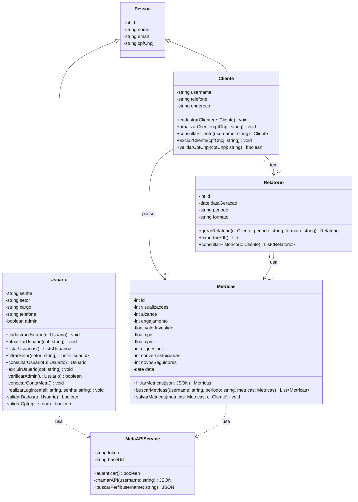

# Documento de Visão

Sistema de Geração de Relatórios para Empresa de Marketing Digital

Documento construído a partir do **Modelo BSI - Doc 001 - Documento de Visão**, que pode ser encontrado no
link: https://docs.google.com/document/d/1DPBcyGHgflmz5RDsZQ2X8KVBPoEF5PdAz9BBNFyLa6A/edit?usp=sharing

## Descrição do Projeto

O projeto consiste em um sistema web para uma empresa de marketing digital que automatiza a elaboração e a gestão de relatórios de desempenho dos clientes nas redes sociais.

**Problema.** A empresa não possui um sistema de armazenamento dos dados dos clientes. As métricas vêm do Instagram, que as mantém disponíveis por apenas 5 a 6 meses. Depois disso, as informações se perdem, e a empresa não consegue atender pedidos de relatórios antigos nem comparar desempenho ao longo do tempo. Além disso, os relatórios são montados manualmente, e cada colaborador usa ferramentas como o Canva de forma individual, sem padronização. O resultado é retrabalho, perda de tempo e inconsistência nas análises.

**Solução.** Um sistema que:

- armazena os dados dos clientes (CPF/CNPJ, nome, e-mail, endereço, telefone e nome de usuário do Instagram) e as métricas de seus perfis (visualizações, alcance, engajamento, valor investido, CPC, CPM, cliques no link, conversas iniciadas e novos seguidores);
- extrai as métricas automaticamente via API da Meta e as guarda em banco de dados, criando um histórico permanente;
- gera relatórios e gráficos de forma automática e padronizada, com exportação em PDF.

**Escopo.** O sistema mantém o cadastro de funcionários da agência e de clientes (contas de redes sociais). O funcionário autenticado pesquisa pelo "@" de um cliente, visualiza um painel web com os indicadores e exporta o relatório em PDF para envio ao cliente.

**Fora do escopo.** Contas de clientes acessando o sistema, publicação de conteúdo nas redes sociais e redes sociais diferentes do Instagram.

## Equipe e Definição de Papéis

Membro | Papel | E-mail |
--------- | ----------- | ---------- |
Flávia Juliana de Araújo Carvalho | Desenvolvedora Front-end | flavia.carvalho.124@ufrn.edu.br
Jaine Souza da Luz | Desenvolvedora Front-end | jaine.luz.138@ufrn.edu.br
Leandro Sérgio da Silva | Desenvolvedor Back-end | leandro.sergio.139@ufrn.edu.br
Lucas da Costa Santos | Desenvolvedor de Banco de Dados | lucas.costa.123@ufrn.edu.br
Karliane Medeiros Ovidio Vale | Cliente Professora | karliane.vale@ufrn.br

### Matriz de Competências

Membro | Competências |
--------- | ----------- |
Flávia Juliana de Araújo Carvalho | Desenvolvimento front-end, HTML, CSS, JavaScript, design de interfaces e prototipação de telas, consumo de APIs
Jaine Souza da Luz | Desenvolvimento front-end, HTML, CSS, JavaScript, design de interfaces e prototipação de telas, consumo de APIs
Leandro Sérgio da Silva | Desenvolvimento back-end, regras de negócio, criação de APIs, integração com a API da Meta, autenticação e segurança
Lucas da Costa Santos | Modelagem e administração de banco de dados, SQL, modelagem relacional, consultas e otimização

## Perfis dos Usuários

O sistema é utilizado apenas por funcionários da agência. Os clientes da agência são entidades cadastradas no sistema, mas não o acessam. Temos os seguintes perfis/atores:

Perfil | Descrição |
--------- | ----------- |
Usuário | Funcionário autenticado da agência. Cadastra e consulta clientes, gera relatórios, consulta o histórico de relatórios e métricas e exporta relatórios em PDF.
Administrador | Especialização de Usuário. Possui todas as funções do Usuário e, além disso, gerencia os usuários do sistema e conecta a conta Meta.

## Lista de Requisitos Funcionais

### Casos de uso e atores

Caso de uso | Requisitos | Ator |
--------- | ----------- | ---------- |
UC01 - Realizar Login | RF01 | Usuário, Administrador |
UC02 - Manter Usuário | RF02 | Administrador |
UC03 - Gerar Relatório | RF03 | Usuário, Administrador |
UC04 - Consultar Histórico | RF04 | Usuário, Administrador |
UC05 - Manter Cliente | RF05 | Usuário, Administrador |
UC06 - Conectar Conta Meta | RF06 | Administrador |
UC07 - Coletar e Armazenar Métricas | RF07 | Usuário, Administrador |

> O Administrador herda todas as funções do Usuário.

### Entidade Usuário - US01 - Autenticação e Manter Usuário
Um usuário tem: CPF, nome, e-mail, senha, setor, cargo, telefone e um indicador de administrador.

Requisito | Descrição | Ator |
--------- | ----------- | ---------- |
RF01.01 - Realizar Login | Realiza login informando e-mail e senha. O usuário deve estar cadastrado e ativo. | Usuário, Administrador |
RF02.01 - Inserir Usuário | Insere novo usuário informando: CPF, nome, e-mail, senha, setor, cargo e telefone. | Administrador |
RF02.02 - Listar Usuários | Lista os usuários com filtro por setor e exibe os dados do usuário selecionado. | Administrador |
RF02.03 - Atualizar Usuário | Atualiza os dados de um usuário previamente consultado. | Administrador |
RF02.04 - Deletar Usuário | Deleta um usuário previamente consultado, após confirmação. | Administrador |

---

### Entidade Cliente - US02 - Manter Cliente
Um cliente representa uma conta atendida pela agência. Tem: CPF/CNPJ, nome, e-mail, endereço, telefone e nome de usuário do Instagram (@).

Requisito | Descrição | Ator |
--------- | ----------- | ---------- |
RF05.01 - Inserir Cliente | Insere novo cliente informando: CPF/CNPJ, nome, e-mail, endereço, telefone e @ do Instagram. O CPF/CNPJ é validado. | Usuário, Administrador |
RF05.02 - Consultar Cliente | Consulta um cliente informando o "@" do Instagram. | Usuário, Administrador |
RF05.03 - Atualizar Cliente | Atualiza os dados de um cliente previamente consultado. | Usuário, Administrador |
RF05.04 - Deletar Cliente | Deleta um cliente previamente consultado, após confirmação. | Usuário, Administrador |

---

### Entidade Métricas - US03 - Coletar e Armazenar Métricas
As métricas são os indicadores de desempenho de um cliente em uma data: visualizações, alcance, engajamento, valor investido, CPC, CPM, cliques no link, conversas iniciadas e novos seguidores.

Requisito | Descrição | Ator |
--------- | ----------- | ---------- |
RF07.01 - Coletar Métricas | Busca o perfil do cliente pelo "@" na API da Meta e obtém as métricas. Informa se o perfil não existe. | Usuário, Administrador |
RF07.02 - Armazenar Métricas | Salva as métricas coletadas no banco de dados, vinculadas ao cliente, formando o histórico. | Usuário, Administrador |

---

### Entidade Relatório - US04 - Gerar Relatório e Consultar Histórico
Um relatório é gerado a partir das métricas de um cliente em um período, com as métricas e o formato escolhidos.

Requisito | Descrição | Ator |
--------- | ----------- | ---------- |
RF03.01 - Gerar Relatório | Gera relatório informando: cliente, período (atual, semanal ou mensal), métricas e formato de visualização (PDF, tabela ou dashboard). Exige conta Meta conectada. | Usuário, Administrador |
RF03.02 - Exportar PDF | Exporta o relatório gerado em PDF com um clique. | Usuário, Administrador |
RF04.01 - Consultar Histórico | Lista os relatórios e as métricas armazenados de um cliente. Informa quando não há registros. | Usuário, Administrador |

---

### Conexão com a Meta - US05 - Conectar Conta Meta

Requisito | Descrição | Ator |
--------- | ----------- | ---------- |
RF06.01 - Conectar Conta Meta | Conecta a conta Meta via autenticação da Meta, autorizando o acesso às contas Instagram Business ou Creator vinculadas para coleta de métricas. | Administrador |

---

### Modelo Conceitual

Abaixo apresentamos o diagrama de classes usando o **Mermaid**.

#### Descrição das Entidades

Entidade | Descrição |
--------- | ----------- |
Pessoa | Classe base com os dados comuns: id, nome, e-mail e CPF/CNPJ. |
Cliente | Conta atendida pela agência. Além dos dados de Pessoa, tem telefone, endereço e o @ do Instagram, usado para buscar métricas. |
Usuario | Funcionário da agência que acessa o sistema. Tem senha, setor, cargo, telefone e indicador de administrador. |
Metricas | Indicadores de desempenho do perfil de um cliente em uma data. Formam o histórico permanente. |
Relatorio | Documento gerado a partir das métricas de um cliente em um período, com formato e data de geração. |
MetaAPIService | Serviço que se comunica com a API da Meta: autentica, chama a API e busca o perfil pelo @. |

### Diagramas UML complementares

Os diagramas abaixo foram elaborados na ferramenta de modelagem do grupo e estão inseridos como imagem. Ajuste os caminhos conforme a pasta do repositório.

- Diagrama de casos de uso: ``
- Diagramas de sequência: Chamar API, Conectar Conta Meta, Fazer Login, Cadastrar/Excluir/Alterar/Consultar Usuário, Gerar Relatório e Consultar Cliente (`img/sequencia-*.png`)
- Diagramas de atividade: Cadastrar/Consultar/Atualizar/Excluir Cliente, Validar CPF/CNPJ, Buscar Perfil, Conectar Conta Meta, Chamar API e Salvar Métricas (`img/atividade-*.png`)

## Lista de Requisitos Não-Funcionais

Requisito | Descrição |
--------- | ----------- |
RNF01 - Desempenho | O sistema deve responder às solicitações de geração de relatórios em até 10 segundos em condições normais de uso. |
RNF02 - Controle de Acesso | Apenas usuários autenticados podem acessar os dados e relatórios. Apenas administradores podem manter usuários e conectar a conta Meta. |
RNF03 - Segurança | O sistema deve proteger os dados dos clientes com criptografia e boas práticas de segurança, como conexão HTTPS e autenticação segura (senhas armazenadas com hash). |
RNF04 - Acessibilidade via navegador | O sistema deve ser acessível via navegador, funcionando no Firefox e no Chrome. |

## Riscos

Tabela com o mapeamento dos riscos do projeto, as possíveis soluções e os responsáveis.

Data | Risco | Prioridade | Responsável | Status | Providência/Solução |
------ | ------ | ------ | ------ | ------ | ------ |
08/11/2026 | Não aprendizado das ferramentas e tecnologias utilizadas pelos integrantes | Alta | Todos | Vigente | Reforçar estudos e fazer sessões de apoio com quem já conhece a ferramenta |
08/11/2026 | Mudanças, limites de uso ou indisponibilidade da API da Meta | Alta | Leandro | Vigente | Estudar a documentação da API e usar dados de teste (mock) para o desenvolvimento |
08/11/2026 | Ausência do cliente (professoras) para validação dos requisitos | Média | Todos | Vigente | Planejar o cronograma com base na agenda das professoras |
08/11/2026 | Divisão de tarefas mal sucedida | Média | Todos | Vigente | Acompanhar de perto o desenvolvimento de cada membro da equipe |
08/11/2026 | Inconsistência entre os artefatos (requisitos, casos de uso e diagramas) | Baixa | Todos | Vigente | Revisar a consistência dos artefatos antes de cada entrega |

### Referências

- Modelo BSI - Doc 001 - Documento de Visão: https://docs.google.com/document/d/1DPBcyGHgflmz5RDsZQ2X8KVBPoEF5PdAz9BBNFyLa6A/edit?usp=sharing
- Projeto Prático - Sistema de Geração de Relatórios (UFRN/CERES, 2026).
- Documentação da API da Meta (Instagram Graph API): https://developers.facebook.com/docs/instagram-platform
