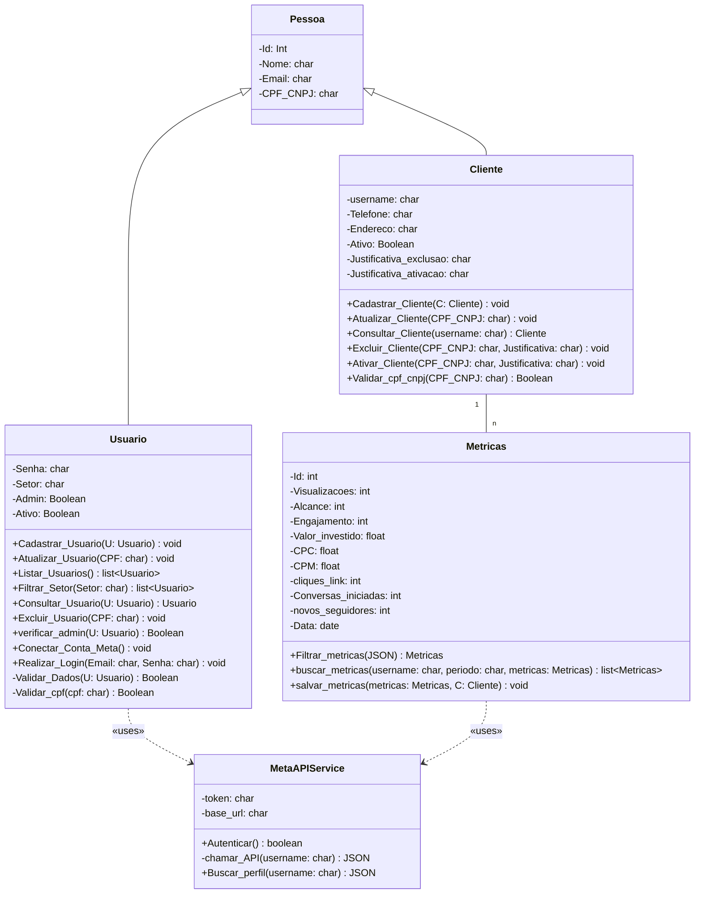
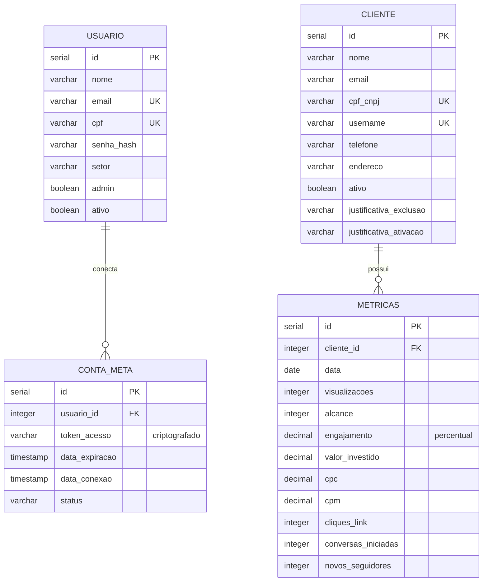

# Documento de Modelos

Este documento apresenta o modelo conceitual (diagrama de classes UML), o modelo de dados (entidade-relacionamento), a descrição das entidades e o dicionário de dados do sistema. Os diagramas foram escritos em [Mermaid](https://mermaid.js.org/), que o GitHub renderiza diretamente no Markdown.

## Modelo Conceitual

### Diagrama de Classes usando Mermaid

### Descrição das Entidades

Descrição sucinta das entidades presentes no sistema.

| Entidade | Descrição |
|---|---|
| **Pessoa** | Entidade que generaliza os dados comuns de Cliente e Usuário. Informações: Id (Int), Nome, Email e CPF/CNPJ. Não possui operações. As classes Cliente e Usuário a estendem. |
| **Cliente** | Entidade que representa o cliente da agência, dono do perfil do Instagram monitorado. Informações próprias: username (o "@"), Telefone, Endereço, Ativo, Justificativa_exclusao e Justificativa_ativacao. Operações: `Cadastrar_Cliente()`, `Atualizar_Cliente()`, `Consultar_Cliente()`, `Excluir_Cliente()` (exclusão lógica, com justificativa), `Ativar_Cliente()` (reativação, com justificativa) e `Validar_cpf_cnpj()`. Estende Pessoa e se relaciona com Metricas (1 para n). |
| **Usuario** | Entidade que representa o funcionário da agência que acessa o sistema. Informações próprias: Senha, Setor, Admin e Ativo. Operações: manter usuários (`Cadastrar_Usuario()`, `Atualizar_Usuario()`, `Listar_Usuarios()`, `Filtrar_Setor()`, `Consultar_Usuario()`, `Excluir_Usuario()`, que é lógica), `verificar_admin()`, `Conectar_Conta_Meta()`, `Realizar_Login()` e as validações privadas `Validar_Dados()` e `Validar_cpf()`. Estende Pessoa e usa MetaAPIService. No modelo de dados, o documento do usuário é armazenado apenas como CPF. |
| **Metricas** | Entidade que representa o registro histórico de desempenho do perfil de um cliente em uma data. Informações: Id, Visualizacoes, Alcance, Engajamento, Valor_investido, CPC, CPM, cliques_link, Conversas_iniciadas, novos_seguidores e Data. Operações: `Filtrar_metricas()`, `buscar_metricas()` e `salvar_metricas()`. Pertence a um Cliente e usa MetaAPIService. |
| **MetaAPIService** | Classe de serviço que isola a integração com a API da Meta. Informações: token e base_url. Operações: `Autenticar()`, `chamar_API()` (privada) e `Buscar_perfil()`. É utilizada por Usuario e Metricas. |

## Modelo de Dados (Entidade-Relacionamento)

O modelo de dados abaixo foi derivado do diagrama de classes. A herança de `Pessoa` foi resolvida copiando seus atributos para as tabelas `CLIENTE` e `USUARIO`, e a classe de serviço `MetaAPIService` não gera tabela, pois não persiste dados próprios. O token de acesso à API da Meta é armazenado na tabela `CONTA_META`.

A exclusão de clientes e de usuários é **lógica**: o registro é marcado como inativo (`ativo = false`) e nunca é removido do banco. No caso do cliente, isso preserva o histórico de métricas, e as justificativas de exclusão e de ativação são armazenadas no próprio registro.

## Dicionário de Dados

### Tabela: Cliente

| | |
|---|---|
| **Tabela** | Cliente |
| **Descrição** | Armazena as informações dos clientes da agência, dos quais o perfil do Instagram é monitorado. |
| **Observação** | O campo `cpf_cnpj` deve ser armazenado sem máscara. O campo `username` corresponde ao "@" do Instagram, sem o símbolo. A exclusão é lógica: o cliente é marcado como `ativo = false` e nunca é removido do banco, preservando o histórico de métricas. `cpf_cnpj` e `username` continuam únicos mesmo para clientes inativos, então um cliente excluído só volta a ser atendido por reativação do cadastro. O tipo do cliente (pessoa física ou jurídica) não é armazenado: é deduzido do tamanho do `cpf_cnpj`, com 11 caracteres para CPF e 14 para CNPJ. O cliente inativo é exibido na interface com o status "Inativo". |

| Nome | Descrição | Tipo de Dado | Tamanho | Restrições de Domínio |
|---|---|---|---|---|
| id | identificador gerado pelo SGBD | SERIAL | --- | PK / Identity |
| nome | nome completo (pessoa física) ou razão social (pessoa jurídica) | VARCHAR | 150 | Not Null |
| email | e-mail de contato do cliente | VARCHAR | 150 | Not Null |
| cpf_cnpj | CPF ou CNPJ do cliente, sem máscara (11 caracteres para CPF e 14 para CNPJ) | VARCHAR | 14 | Unique / Not Null |
| username | nome de usuário do Instagram (@) | VARCHAR | 30 | Unique / Not Null |
| telefone | telefone de contato do cliente | VARCHAR | 15 | Not Null |
| endereco | endereço completo do cliente (rua, número, bairro, cidade e estado) | VARCHAR | 200 | Not Null |
| ativo | indica se o cliente está ativo no sistema | BOOLEAN | --- | Not Null / Default true |
| justificativa_exclusao | motivo informado na exclusão (inativação) do cliente | VARCHAR | 250 | Obrigatória ao inativar (validada pela API) |
| justificativa_ativacao | motivo informado na reativação do cliente | VARCHAR | 250 | Obrigatória ao reativar (validada pela API) |

### Tabela: Usuario

| | |
|---|---|
| **Tabela** | Usuario |
| **Descrição** | Armazena as informações dos funcionários da agência que acessam o sistema. |
| **Observação** | A senha deve ser armazenada apenas como hash, nunca em texto puro. Usuários com `admin = true` podem manter outros usuários. Apenas usuários com `ativo = true` podem realizar login. O CPF deve ser armazenado apenas com números, sem máscara. A exclusão de usuário é lógica: o usuário é marcado como `ativo = false` e não é removido do banco. |

| Nome | Descrição | Tipo de Dado | Tamanho | Restrições de Domínio |
|---|---|---|---|---|
| id | identificador gerado pelo SGBD | SERIAL | --- | PK / Identity |
| nome | nome completo do funcionário | VARCHAR | 150 | Not Null |
| email | e-mail utilizado para login | VARCHAR | 150 | Unique / Not Null |
| cpf | CPF do funcionário, somente números | VARCHAR | 11 | Unique / Not Null |
| senha_hash | hash da senha de acesso | VARCHAR | 255 | Not Null |
| setor | setor em que o funcionário atua | VARCHAR | 50 | Not Null |
| admin | indica se o usuário é administrador | BOOLEAN | --- | Not Null / Default false |
| ativo | indica se o usuário está ativo no sistema | BOOLEAN | --- | Not Null / Default true |

### Tabela: Conta_Meta

| | |
|---|---|
| **Tabela** | Conta_Meta |
| **Descrição** | Armazena a conexão do usuário com a conta da Meta, que autoriza o acesso às contas do Instagram Business ou Creator para coleta de métricas pela API. |
| **Observação** | O `token_acesso` deve ser armazenado criptografado. Um usuário pode ter mais de uma conexão registrada. O status indica se a conexão está ativa, expirada ou revogada. |

| Nome | Descrição | Tipo de Dado | Tamanho | Restrições de Domínio |
|---|---|---|---|---|
| id | identificador gerado pelo SGBD | SERIAL | --- | PK / Identity |
| usuario_id | usuário que realizou a conexão | INTEGER | --- | FK / Not Null |
| token_acesso | token de acesso à API da Meta, criptografado | VARCHAR | 500 | Not Null |
| data_expiracao | data e hora de expiração do token | TIMESTAMP | --- | --- |
| data_conexao | data e hora em que a conta foi conectada | TIMESTAMP | --- | Not Null / Default now |
| status | situação da conexão (ativa, expirada ou revogada) | VARCHAR | 20 | Not Null / Default 'ativa' |

### Tabela: Metricas

| | |
|---|---|
| **Tabela** | Metricas |
| **Descrição** | Armazena o histórico de métricas de desempenho do perfil de cada cliente, coletadas por data. |
| **Observação** | Cada registro pertence a um único cliente. Não pode haver dois registros do mesmo cliente na mesma data (`UNIQUE (cliente_id, data)`). O engajamento é armazenado como percentual (0 a 100). Os valores monetários estão em reais. |

| Nome | Descrição | Tipo de Dado | Tamanho | Restrições de Domínio |
|---|---|---|---|---|
| id | identificador gerado pelo SGBD | SERIAL | --- | PK / Identity |
| cliente_id | cliente ao qual a métrica pertence | INTEGER | --- | FK / Not Null |
| data | data de referência da coleta | DATE | --- | Not Null |
| visualizacoes | total de visualizações | INTEGER | --- | Not Null / Default 0 |
| alcance | total de contas alcançadas | INTEGER | --- | Not Null / Default 0 |
| engajamento | taxa de engajamento em percentual | DECIMAL | 5,2 | Not Null / Check (0 a 100) |
| valor_investido | valor investido em anúncios | DECIMAL | 10,2 | Not Null / Default 0 |
| cpc | custo por clique | DECIMAL | 10,2 | Not Null / Default 0 |
| cpm | custo por mil visualizações | DECIMAL | 10,2 | Not Null / Default 0 |
| cliques_link | total de cliques no link | INTEGER | --- | Not Null / Default 0 |
| conversas_iniciadas | total de conversas iniciadas | INTEGER | --- | Not Null / Default 0 |
| novos_seguidores | total de novos seguidores | INTEGER | --- | Not Null / Default 0 |