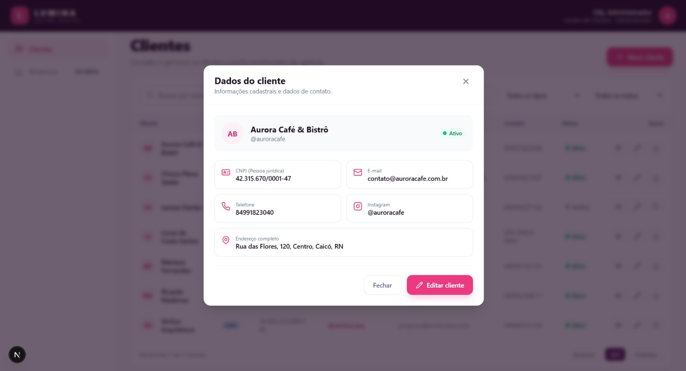
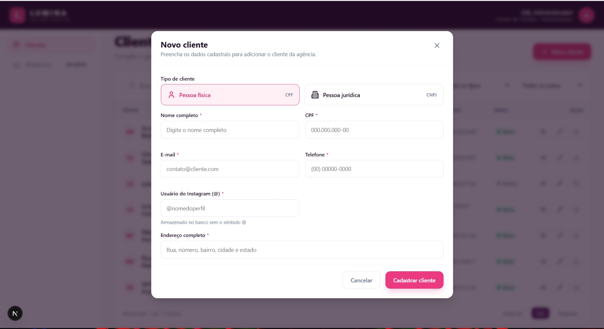
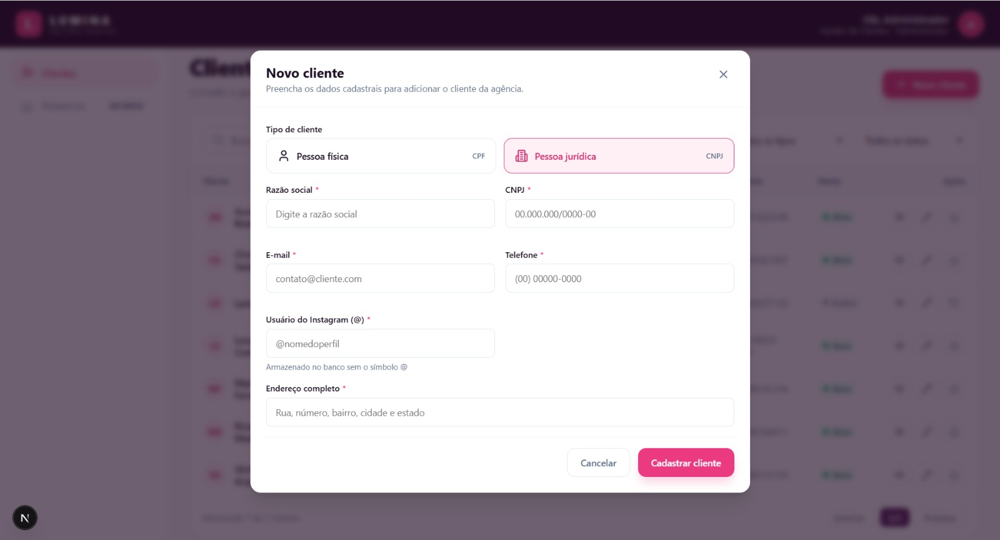
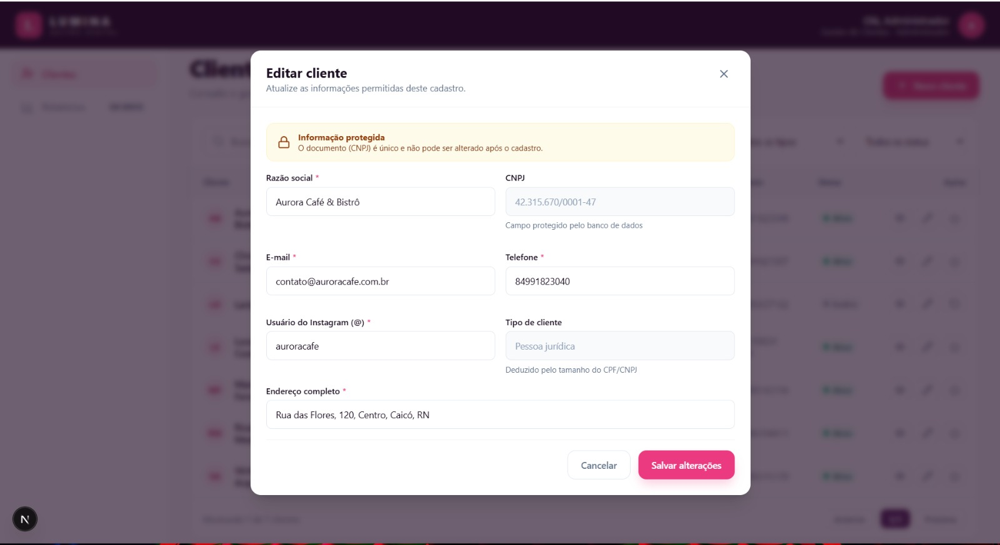
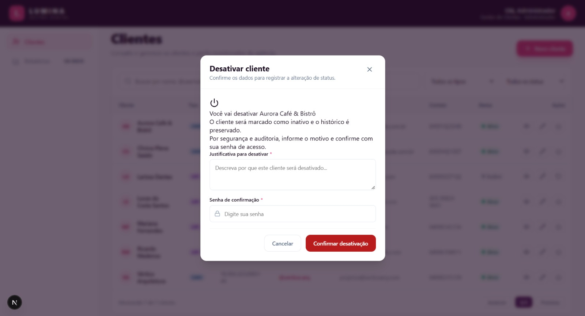
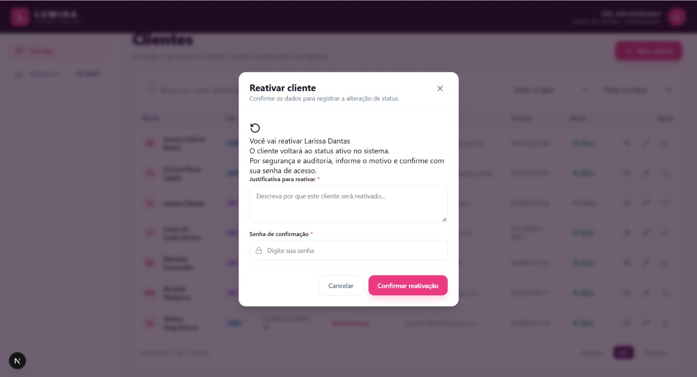

# PROJETO PRÁTICO - LUMINA
 
**Alunos:** 
- FLÁVIA JULIANA DE ARAÚJO CARVALHO
- JAINE SOUZA DA LUZ
- LEANDRO SÉRGIO DA SILVA  
- LUCAS DA COSTA SANTOS

**Professora:** Karliane Medeiros Ovidio Vale  
**Disciplina:** Engenharia de Software I

## 1. INTRODUÇÃO

### 1.1 Contexto

Na disciplina de Organização, Sistemas e Métodos (OSM), foi elaborado o planejamento de um sistema de automação de relatórios de desempenho para uma empresa de marketing digital. O diagnóstico realizado na ocasião identificou que a empresa não possuía armazenamento interno dos dados de seus clientes. As métricas do Instagram permanecem disponíveis por apenas cerca de cinco a seis meses e, após esse período, são perdidas. Além disso, os relatórios eram produzidos manualmente, sem padronização. Como resposta, o projeto propôs um sistema que armazena os dados cadastrais e as métricas dos clientes, mantém um histórico de desempenho e automatiza a geração de relatórios.

Na disciplina de Engenharia de Software I, a terceira unidade teve como objetivo a implementação de parte desse projeto, utilizando o Scrum como método de desenvolvimento. A atividade, orientada pela Profª Karliane Medeiros Ovidio Vale, exigiu a criação do repositório no GitHub com a definição das tecnologias no arquivo README.md, a elaboração dos documentos de visão e de modelos no diretório `docs`, a implementação de ao menos um CRUD do projeto e a execução de duas sprints, cada uma com planejamento, revisão e retrospectiva.

### 1.2 Objetivo do relatório

Este relatório documenta a aplicação do Scrum no desenvolvimento do projeto. São apresentados o Product Backlog, o planejamento, a execução, a revisão e a retrospectiva de cada sprint, as reuniões realizadas, os resultados alcançados, os problemas enfrentados e o CRUD implementado.

### 1.3 Escopo implementado

Foi implementado o CRUD de Clientes, correspondente ao caso de uso Manter Cliente do projeto de OSM. O módulo permite cadastrar clientes pessoa física (CPF) e pessoa jurídica (CNPJ), consultar a lista de clientes com busca por nome, "@" do Instagram, documento ou e-mail e filtros por tipo e status, visualizar os dados de cada cliente e editar as informações permitidas.

A escolha desse CRUD justifica-se por duas razões. A primeira é que o cadastro de clientes é a base das demais funcionalidades, já que as métricas e os relatórios dependem de clientes registrados. A segunda é que esse caso de uso já estava documentado no projeto de OSM, por meio de casos de uso, diagrama de classes e diagramas de sequência e de atividade.

A implementação apresenta duas adaptações em relação ao projeto original. A primeira é que o CPF/CNPJ e o tipo de cliente não podem ser alterados após o cadastro. A segunda é que a operação de exclusão foi substituída pela inativação e reativação do cadastro, que exigem justificativa e confirmação por senha. Com isso, o registro permanece disponível para consulta, preservando o histórico, que é justamente o problema central apontado no diagnóstico inicial. No back-end, a exclusão física é bloqueada.

### 1.4 Tecnologias utilizadas

O sistema foi desenvolvido em duas camadas independentes. O front-end utiliza React com Next.js, em JavaScript, com interface responsiva e componentes reutilizáveis, como tabela, janelas modais e campos com máscara para CPF, CNPJ e telefone. O back-end é uma API REST construída em Python com Django e Django REST Framework, com validação de CPF/CNPJ e e-mail, busca textual, filtros, paginação e testes automatizados. Os dados são armazenados em um banco PostgreSQL 16 executado em contêiner Docker. O código-fonte e a documentação foram versionados em repositório no GitHub, com uso de issues, branches e pull requests.

### 1.5 Organização do desenvolvimento

O desenvolvimento foi dividido em duas sprints de uma semana cada. A Sprint 1 ocorreu de 05/11 a 12/11, com reuniões na quinta-feira, na sexta-feira e na terça-feira. A Sprint 2 ocorreu de 12/11 a 19/11, com reuniões na sexta-feira, na segunda-feira e na quarta-feira.

A Sprint 1 foi concluída conforme o planejado. Na Sprint 2, a implementação do back-end não foi finalizada dentro do prazo estabelecido (19/11, até as 15h) e foi concluída ao final do mesmo dia. Esse episódio é analisado nas seções seguintes.

Este documento está organizado em: fundamentação teórica do Scrum; organização do time; Product Backlog; Sprint 1 e Sprint 2; consolidado das reuniões; análise geral da aplicação do Scrum; resultado final do produto; e conclusão.

## 2. FUNDAMENTAÇÃO TEÓRICA

### 2.1 O Scrum

O Scrum é um framework ágil para o desenvolvimento de produtos complexos, baseado em entregas incrementais e na adaptação contínua do trabalho. Em vez de definir todo o produto no início, o trabalho é dividido em ciclos curtos e de duração fixa, chamados sprints. Ao final de cada ciclo, uma parte utilizável do produto deve estar pronta para ser avaliada (SCHWABER; SUTHERLAND, 2020).

O framework é sustentado por três pilares. A transparência exige que os aspectos relevantes do trabalho sejam visíveis a todos os envolvidos. A inspeção exige que o produto e o progresso sejam verificados com frequência, para detectar desvios. A adaptação exige que o trabalho seja ajustado assim que um desvio for identificado.

O Scrum também se apoia em cinco valores: comprometimento, foco, abertura, respeito e coragem. Esses valores orientam o comportamento do time e as decisões tomadas ao longo das sprints.

### 2.2 Papéis

O time Scrum é formado por três responsabilidades:

- **Product Owner:** responsável por maximizar o valor do produto. Gerencia o Product Backlog, definindo e priorizando seus itens de acordo com as necessidades do cliente.
- **Scrum Master:** responsável por garantir que o Scrum seja compreendido e aplicado. Facilita os eventos, auxilia o time a remover impedimentos e promove a melhoria contínua.
- **Time de Desenvolvimento:** profissionais que realizam o trabalho de construir o incremento do produto em cada sprint. É um grupo autogerenciado, que decide como transformar os itens selecionados em entregas. A versão mais recente do Guia do Scrum (2020) usa o termo "Desenvolvedores" para esse papel.

Além desses papéis, o Scrum considera a participação dos stakeholders, que são as partes interessadas no produto e podem fornecer informações, necessidades e feedback ao longo do desenvolvimento.

### 2.3 Eventos

Os eventos do Scrum têm duração limitada e criam uma rotina regular de planejamento e verificação:

- **Sprint:** ciclo de duração fixa, de no máximo um mês, em que um incremento utilizável é produzido. Contém todos os demais eventos. Uma nova sprint começa imediatamente após o término da anterior.
- **Sprint Planning (planejamento da sprint):** reunião em que o time define o que será entregue na sprint e como o trabalho será realizado. Seu resultado é o Sprint Backlog, associado a uma meta da sprint.
- **Daily Scrum (reunião diária):** reunião curta em que o time inspeciona o progresso em direção à meta da sprint e ajusta o plano das atividades seguintes.
- **Sprint Review (revisão da sprint):** reunião ao final de cada sprint para inspecionar o incremento produzido e coletar feedback, podendo resultar em ajustes no Product Backlog.
- **Sprint Retrospective (retrospectiva da sprint):** reunião em que o time analisa a própria forma de trabalhar, identificando o que funcionou, o que não funcionou e quais melhorias serão adotadas na sprint seguinte.

### 2.4 Artefatos

Os artefatos do Scrum representam trabalho ou valor e existem para promover a transparência:

- **Product Backlog:** lista ordenada de tudo o que é necessário para o produto, como funcionalidades, correções e melhorias. É dinâmica e evolui conforme o produto e o contexto mudam. Seus itens costumam ser descritos como histórias de usuário.
- **Sprint Backlog:** conjunto de itens do Product Backlog selecionados para a sprint, acrescido do plano de como entregá-los. Pertence ao time de desenvolvimento e pode ser ajustado durante a sprint. Itens não concluídos retornam ao Product Backlog.
- **Incremento:** resultado utilizável da sprint, que soma as entregas atuais às das sprints anteriores. Só é considerado um incremento quando atende à Definição de Pronto.

### 2.5 Definição de Pronto

A Definição de Pronto (Definition of Done) é um acordo formal do time sobre os critérios que um item deve cumprir para ser considerado concluído. Ela garante uma compreensão comum de qualidade, evitando que cada integrante interprete "pronto" de forma diferente. Um item que não atende à Definição de Pronto não pode ser entregue nem apresentado na Sprint Review, voltando ao Product Backlog.

### 2.6 O Scrum no contexto da disciplina

Na disciplina de Engenharia de Software I, o Scrum foi aplicado com adaptações compatíveis com o ambiente acadêmico. O cronograma da disciplina definiu sprints de uma semana, com o planejamento e a revisão realizados em sala de aula e a retrospectiva conduzida pelos próprios grupos. A professora acompanhou as entregas e avaliou se os resultados estavam de acordo com as exigências da atividade. Essas adaptações, bem como a distribuição das responsabilidades na equipe, são descritas na seção seguinte.

## 3. ORGANIZAÇÃO DO TIME E ADAPTAÇÃO DO SCRUM

### 3.1 Integrantes, responsabilidades e stakeholder

A equipe foi composta por quatro integrantes, que participaram do projeto de OSM e deram continuidade a ele na disciplina de Engenharia de Software I: Flávia Juliana de Araújo Carvalho, Jaine Souza da Luz, Leandro Sérgio da Silva e Lucas da Costa Santos.

A distribuição das responsabilidades técnicas ocorreu de acordo com as atividades necessárias ao desenvolvimento, conforme apresentado no quadro a seguir.

| Integrante | Atuação na equipe | Responsabilidades técnicas |
|---|---|---|
| Flávia Juliana de Araújo Carvalho | Desenvolvedora | Prototipação das telas e implementação do front-end |
| Jaine Souza da Luz | Desenvolvedora | Prototipação das telas e implementação do front-end |
| Leandro Sérgio da Silva | Desenvolvedor | Implementação do back-end das funcionalidades e integração entre front-end e back-end |
| Lucas da Costa Santos | Desenvolvedor e testador | Configuração e criação do banco de dados, realização de testes e verificação das funcionalidades implementadas |

Não houve um integrante formalmente definido para exercer a função de Scrum Master. A equipe optou por compartilhar as responsabilidades relacionadas à organização e ao acompanhamento do trabalho. Dessa forma, todos contribuíram para a comunicação, a identificação de dificuldades, a distribuição das atividades e o apoio aos demais integrantes durante as sprints. Essa decisão ocorreu porque todos estavam envolvidos diretamente na construção do produto e precisavam colaborar para que as entregas fossem realizadas.

O papel de Product Owner também foi compartilhado entre os quatro integrantes. Não houve uma pessoa responsável individualmente por definir e priorizar o Product Backlog. Os itens foram derivados dos requisitos e dos casos de uso do projeto de OSM, e a ordem de execução foi discutida em conjunto nas reuniões de planejamento. Na prática, todos puderam opinar sobre o que seria desenvolvido em cada sprint.

A professora Karliane Medeiros Ovidio Vale atuou como stakeholder do projeto, representando a parte interessada responsável por acompanhar e avaliar as entregas no contexto da disciplina. Durante as revisões, verificou se o desenvolvimento e os resultados apresentados estavam de acordo com as orientações e exigências estabelecidas para a atividade, além de fornecer recomendações para a continuidade do trabalho.

### 3.2 Tecnologias e ferramentas

**Front-end.** A interface foi desenvolvida com React e Next.js, em JavaScript. O React permite construir a tela a partir de componentes reutilizáveis, como a tabela de clientes, as janelas modais de cadastro, detalhes, edição e alteração de status, e os campos de formulário com máscara para CPF, CNPJ e telefone. O Next.js fornece a estrutura da aplicação, a organização das páginas e o servidor de desenvolvimento, que executa na porta 3000. O layout é responsivo e foi escrito com CSS tradicional, e os ícones vêm da biblioteca Lucide. A comunicação com o back-end ocorre por requisições HTTP a uma API REST.

**Back-end.** O back-end foi desenvolvido em Python com o framework Django e o Django REST Framework, que facilita a criação de APIs REST. Ele expõe os endpoints do CRUD de clientes: listagem com busca e filtros, cadastro, consulta por identificador, atualização e alteração de status. Nele ficam as regras de negócio, como a validação de CPF, CNPJ e e-mail, a unicidade do documento e do usuário do Instagram, a justificativa obrigatória na inativação e reativação e o bloqueio da exclusão física. A biblioteca django-cors-headers permite que o front-end, em outra porta, acesse a API, e a psycopg faz a conexão com o banco. A API executa na porta 3001 e conta com testes automatizados.

**Banco de dados.** Os dados são armazenados em PostgreSQL 16. A tabela de clientes é criada por meio das migrations do Django, e um conjunto de clientes de exemplo, carregado por uma fixture, permite testar o sistema sem cadastrar dados manualmente.

**Ferramentas de apoio.**

| Ferramenta | Uso no projeto |
|---|---|
| GitHub | Versionamento do código e da documentação, registro das tarefas em issues, uso de branches por atividade e pull requests para integração |
| Docker | Execução do PostgreSQL em contêiner, o que padroniza o ambiente do banco de dados entre os integrantes |
| VS Code | Editor utilizado no desenvolvimento do código |
| WhatsApp | Principal canal de comunicação da equipe |

### 3.3 Cronograma das sprints e eventos

O desenvolvimento foi organizado em duas sprints de uma semana cada. O planejamento e a revisão de cada sprint foram realizados em sala de aula, em datas definidas pela professora, que acompanhou os resultados de cada grupo. A retrospectiva foi realizada pela própria equipe.

| Sprint | Período | Planejamento | Revisão | Prazo final |
|---|---|---|---|---|
| Sprint 1 | 05/11 a 12/11 | 05/11 (quinta-feira) | 11/11 (quarta-feira) e 12/11 (quinta-feira) | 12/11, até as 15h |
| Sprint 2 | 12/11 a 19/11 | 12/11 (quinta-feira) | 18/11 (quarta-feira) e 19/11 (quinta-feira) | 19/11, até as 15h |

### 3.4 Reuniões da equipe

Em cada sprint, a equipe realizou três reuniões de acompanhamento, nas quais discutiu o andamento das atividades e organizou as tarefas seguintes. Elas substituíram a reunião diária prevista no Scrum.

| Sprint | Reunião | Data | Dia da semana |
|---|---|---|---|
| Sprint 1 | 1ª | 05/11 | Quinta-feira |
| Sprint 1 | 2ª | 06/11 | Sexta-feira |
| Sprint 1 | 3ª | 10/11 | Terça-feira |
| Sprint 2 | 1ª | 13/11 | Sexta-feira |
| Sprint 2 | 2ª | 16/11 | Segunda-feira |
| Sprint 2 | 3ª | 18/11 | Quarta-feira |

### 3.5 Adaptações realizadas

O Scrum foi aplicado com algumas adaptações em relação ao framework original. A reunião diária foi substituída por três reuniões de acompanhamento por sprint, e as sprints tiveram duração de uma semana, com datas de início e término definidas previamente.

O planejamento e a revisão ocorreram em sala de aula, com a presença da professora, que atuou como stakeholder e avaliou se as entregas estavam de acordo com as exigências da disciplina. A retrospectiva foi conduzida pela própria equipe.

Quanto aos papéis, não houve um Scrum Master formalmente definido, pois as responsabilidades de organização, acompanhamento e apoio foram compartilhadas entre os integrantes. O Product Owner também foi uma responsabilidade compartilhada, uma vez que todos participaram das decisões relacionadas ao Product Backlog. Lucas ficou responsável pela configuração e criação do banco de dados e também atuou como testador do sistema. As demais responsabilidades técnicas foram distribuídas conforme as atividades de front-end e back-end.

As tarefas foram registradas como issues no GitHub, e a integração do código foi feita por pull requests.

## 4. PRODUCT BACKLOG

O Product Backlog foi elaborado em sala de aula, em 05/11, a partir dos requisitos e casos de uso do projeto de OSM e das atividades exigidas pela disciplina: repositório, documentação, protótipos e implementação de ao menos um CRUD. Como o escopo era o CRUD de clientes (caso de uso Manter Cliente, requisitos RF05.01 a RF05.04), os demais requisitos do sistema (login, manutenção de usuários, conexão com a conta Meta, coleta de métricas, geração de relatórios e consulta de histórico) permaneceram no backlog do produto, sem planejamento para esta unidade.

| ID | Item | Origem | Responsáveis | Sprint |
|---|---|---|---|---|
| PB01 | Criar o repositório e o README com a definição das tecnologias | Exigência da disciplina | Lucas | 1 |
| PB02 | Elaborar o documento de visão | Exigência da disciplina | Leandro | 1 |
| PB03 | Elaborar o documento de modelos (diagrama de classes, modelo de dados e dicionário de dados) | Exigência da disciplina | Lucas | 1 |
| PB04 | Elaborar os protótipos das telas do CRUD de clientes | RF05 | Flávia e Jaine | 1 |
| PB05 | Configurar o banco de dados PostgreSQL com Docker | RF05 | Lucas | 1 |
| PB06 | Criar o projeto Django conectado ao banco e o model Cliente, com migração e dados de teste | RF05 | Lucas | 2 |
| PB07 | Implementar as telas do front-end (layout, componentes e módulo de clientes) | RF05 | Flávia e Jaine | 2 |
| PB08 | Implementar a API REST do CRUD de clientes | RF05.01 a RF05.04 | Leandro | 2 |
| PB09 | Integrar o front-end ao back-end | RF05 | Leandro | 2 |
| PB10 | Realizar testes e verificar o funcionamento das funcionalidades implementadas | Qualidade | Lucas | 2 |

A equipe não atribuiu prioridades nem estimativas aos itens e não formalizou uma Definição de Pronto. A ordem de execução seguiu a dependência natural entre as atividades: documentação, protótipos e banco de dados primeiro, e só depois as telas, a API e a integração. Essa ausência é discutida na seção 8.

## 5. SPRINT 1

### 5.1 Planejamento

O planejamento da Sprint 1 foi realizado em sala de aula, em 05/11 (quinta-feira), logo após a elaboração do Product Backlog. A sprint teve início nessa data e prazo final em 12/11, até as 15h. A meta foi produzir a base do projeto: a documentação inicial, os protótipos das telas do CRUD de clientes e o banco de dados. Foram selecionados os itens PB01 a PB05 e as tarefas foram registradas como issues no GitHub.

### 5.2 Execução

Durante a sprint, a equipe realizou três reuniões de acompanhamento: 05/11 (quinta-feira), 06/11 (sexta-feira) e 10/11 (terça-feira). Nelas foram revisadas as atividades em andamento, identificados os integrantes que precisavam de apoio e discutidas as dificuldades encontradas. O trabalho foi dividido conforme as atividades de cada integrante: a documentação ficou com Leandro e Lucas, os protótipos com Flávia e Jaine, e o banco de dados com Lucas.

### 5.3 Resultados

Ao final da sprint, foram entregues o README com as tecnologias e a equipe, o documento de visão, o documento de modelos, os protótipos das telas e a definição do banco de dados PostgreSQL com Docker. Todos os itens planejados foram concluídos dentro do prazo.

### 5.4 Revisão

A revisão ocorreu em sala de aula, nos dias 11/11 e 12/11. A professora avaliou os resultados e informou que a equipe estava adiantada em relação ao cronograma, orientando que seguisse no mesmo ritmo. Também recomendou que a elaboração do relatório fosse iniciada desde já.

### 5.5 Retrospectiva

A equipe avaliou que a sprint transcorreu bem. A divisão dos integrantes por especialidade funcionou e permitiu que as atividades avançassem em paralelo, o que resultou na conclusão do planejado com folga. Como ponto de atenção, a orientação da professora reforçou a necessidade de registrar o processo ao longo do desenvolvimento, e não apenas ao final.

## 6. SPRINT 2

### 6.1 Planejamento

O planejamento da Sprint 2 foi realizado em sala de aula, em 12/11 (quinta-feira), data de encerramento da sprint anterior. A sprint teve prazo final em 19/11, até as 15h. A meta foi implementar o CRUD de clientes de ponta a ponta: as telas do front-end, a API do back-end e a comunicação entre as duas camadas e o banco de dados. Foram selecionados os itens PB06 a PB10.

### 6.2 Execução

A equipe realizou três reuniões de acompanhamento: 13/11 (sexta-feira), 16/11 (segunda-feira) e 18/11 (quarta-feira). O desenvolvimento seguiu a divisão de tarefas definida no planejamento. O registro do repositório permite reconstituir a sequência de atividades:

| Data | Atividade |
|---|---|
| 16/11 (segunda-feira) | Criação do projeto Django conectado ao PostgreSQL e do model Cliente, com migração e dados de teste |
| 17/11 (terça-feira) | Implementação do front-end: estrutura do projeto, componentes reutilizáveis, tabela de clientes e janelas modais, com ajuste da estrutura inicial (TypeScript e Tailwind) para JavaScript e CSS tradicional |
| 18/11 (quarta-feira) | Integração das branches do front-end ao ramo de desenvolvimento |
| 19/11 (quinta-feira) | Integração do model ao ramo de desenvolvimento e implementação da API REST, com 14 testes automatizados, ainda no mesmo dia |

Durante essa etapa, Lucas também ficou responsável por verificar o funcionamento das funcionalidades implementadas, contribuindo com os testes do sistema e a identificação de possíveis problemas.

### 6.3 Resultados

Ao final da sprint, o CRUD de clientes estava completo e integrado: as telas de cadastro (pessoa física e jurídica), consulta, edição, inativação e reativação, a API REST correspondente, o banco de dados e a comunicação entre as três camadas.

### 6.4 Atraso na entrega do back-end

O prazo da sprint era 19/11, às 15h. O front-end e o banco de dados foram concluídos dentro do prazo, mas a implementação do back-end não foi finalizada a tempo e foi entregue por volta das 18h do mesmo dia, cerca de três horas após o limite. Como a integração entre as camadas dependia da API, essa etapa também foi concluída após o prazo.

A principal causa foi a dificuldade da equipe na gestão do tempo, agravada pelo acúmulo de atividades de outras disciplinas no período. O back-end foi o último item da cadeia de dependências (banco de dados, model, API e integração), de modo que qualquer atraso nas etapas anteriores se acumulava sobre ele, e problemas técnicos encontrados na implementação também consumiram tempo.

Para mitigar o atraso, a equipe concluiu o back-end e a integração no mesmo dia, o que evitou que itens da sprint retornassem ao Product Backlog. Em seguida, após orientação da professora na revisão, realizou um novo planejamento para concluir as revisões pendentes até a quarta-feira da semana seguinte (25/11), contemplando testes do sistema, revisão do código, elaboração deste relatório e preparação da apresentação. O último teste do sistema foi realizado em 22/11, sem identificação de falhas.

### 6.5 Revisão

A revisão ocorreu em sala de aula, nos dias 18/11 e 19/11. A professora tomou conhecimento do atraso e orientou que ele fosse detalhado no relatório, junto com as ações adotadas para mitigá-lo. Orientou também que a equipe elaborasse um novo planejamento para concluir o trabalho até a quarta-feira da semana seguinte, o que foi feito.

### 6.6 Retrospectiva

A equipe concluiu que a divisão dos integrantes por especialidade funcionou muito bem e que o sistema pôde ser implementado no tempo necessário, apesar do atraso. O atraso decorreu de dificuldades técnicas e de gestão do tempo, mas foi resolvido com a disponibilidade de uma semana adicional para revisões.

Como melhorias para o futuro, a equipe identificou a necessidade de planejar as atividades de maior dependência, como o back-end, para o início da sprint, definir prioridades e estimativas, e prever uma margem de tempo para imprevistos. Também foi considerada importante a continuidade da colaboração entre todos os integrantes, tanto na organização das atividades quanto na identificação e resolução de problemas.

## 7. REUNIÕES

As reuniões de acompanhamento tiveram como pauta a revisão do que estava sendo feito, a identificação de integrantes que precisavam de ajuda, a forma como as funcionalidades estavam sendo implementadas e os problemas encontrados no desenvolvimento. Elas se mostraram um canal mais eficaz do que as conversas no WhatsApp, nas quais as informações se perdem com facilidade, e serviram também para dividir tarefas.

O quadro a seguir consolida todos os eventos do período.

| Data | Sprint | Evento | Pauta |
|---|---|---|---|
| 05/11 (quinta-feira) | 1 | Elaboração do Product Backlog e planejamento da sprint (em sala) | Definição dos itens e das tarefas da Sprint 1 |
| 05/11 (quinta-feira) | 1 | Reunião de acompanhamento 1 | Início das atividades e divisão de tarefas |
| 06/11 (sexta-feira) | 1 | Reunião de acompanhamento 2 | Andamento das atividades e apoio entre os integrantes |
| 10/11 (terça-feira) | 1 | Reunião de acompanhamento 3 | Fechamento das entregas da sprint |
| 11/11 e 12/11 | 1 | Revisão e retrospectiva (em sala) | Avaliação pela professora e retrospectiva da equipe |
| 12/11 (quinta-feira) | 2 | Planejamento da sprint (em sala) | Definição das tarefas da Sprint 2 |
| 13/11 (sexta-feira) | 2 | Reunião de acompanhamento 1 | Início da implementação e divisão de tarefas |
| 16/11 (segunda-feira) | 2 | Reunião de acompanhamento 2 | Andamento do front-end e do banco de dados |
| 18/11 (quarta-feira) | 2 | Reunião de acompanhamento 3 | Andamento do back-end e da integração |
| 18/11 e 19/11 | 2 | Revisão e retrospectiva (em sala) | Avaliação pela professora, atraso do back-end e retrospectiva da equipe |

## 8. ANÁLISE GERAL DA APLICAÇÃO DO SCRUM

### 8.1 Planejado versus realizado

| Sprint | Planejado | Realizado | Situação |
|---|---|---|---|
| 1 (05/11 a 12/11) | Documentação inicial, protótipos das telas e banco de dados | Todos os itens entregues | Concluída no prazo |
| 2 (12/11 a 19/11) | Telas, API REST e integração entre as camadas | Todos os itens entregues; back-end e integração por volta das 18h, após o prazo das 15h | Concluída com atraso de cerca de três horas |

### 8.2 O que funcionou

A divisão das tarefas por especialidade (front-end, banco de dados e back-end) permitiu que as frentes avançassem em paralelo e foi apontada pela equipe como o principal acerto. A colaboração entre os integrantes também foi importante, pois as responsabilidades de acompanhamento e organização não ficaram concentradas em uma única pessoa.

As reuniões de acompanhamento mantiveram todos informados do andamento e facilitaram a identificação de quem precisava de apoio. O acompanhamento da professora, como stakeholder, permitiu avaliar as entregas e receber orientações para a continuidade do trabalho. O uso do GitHub, com issues, branches e pull requests, deu visibilidade ao trabalho e organizou a integração do código. Por fim, o replanejamento após o atraso permitiu concluir o sistema com margem para revisões e testes.

## 8.3 O que não funcionou

O atraso do back-end na Sprint 2 foi o principal problema. Ele revelou a dificuldade da equipe em estimar e administrar o tempo e a concentração de risco em uma única atividade da qual as demais dependiam.

Além disso, a equipe não definiu prioridades, estimativas nem Definição de Pronto, o que enfraqueceu o planejamento e dificultou medir o progresso e decidir quando um item estava de fato concluído. O registro do processo (backlog, retrospectivas) também só foi consolidado ao final, apesar da orientação da professora, na primeira revisão, para que o relatório fosse iniciado cedo.

Outra adaptação foi a ausência de um Scrum Master formalmente designado. Embora a equipe tenha compartilhado as responsabilidades de organização e acompanhamento, a falta de uma pessoa especificamente responsável por facilitar o processo poderia dificultar a identificação de impedimentos e o acompanhamento sistemático das atividades.

### 8.4 Lições aprendidas

A experiência indica que, em uma próxima aplicação, convém iniciar logo as atividades com mais dependências, atribuir estimativas aos itens para identificar sobrecarga, reservar uma margem de tempo para imprevistos, definir de forma explícita o que significa "pronto" e registrar o processo ao longo das sprints.

Também foi possível perceber a importância de distribuir as responsabilidades de maneira clara, mesmo quando a equipe opta por trabalhar de forma colaborativa e sem designar formalmente um Scrum Master. O acompanhamento das atividades precisa ser uma responsabilidade de todos, mas deve ocorrer de maneira organizada.

A experiência indica ainda que o Scrum se mostrou útil mesmo com um time pequeno e responsabilidades compartilhadas, pois a inspeção e a adaptação ao final de cada sprint permitiram identificar o atraso e corrigi-lo a tempo.

## 9. RESULTADO FINAL DO PRODUTO

O CRUD de clientes foi implementado integralmente, com front-end, API REST e banco de dados em funcionamento conjunto. O último teste, realizado em 22/11, não identificou falhas.

### 9.1 Telas implementadas

A tela inicial exibe a lista de clientes com busca por nome, "@" do Instagram, documento ou e-mail, filtros por tipo e status e ações por linha. O cadastro permite escolher entre pessoa física (nome e CPF) e pessoa jurídica (razão social e CNPJ), informando também e-mail, telefone, usuário do Instagram e endereço. A consulta exibe os dados completos do cliente, a edição permite alterar as informações permitidas, e a inativação e a reativação pedem uma justificativa.

As figuras a seguir apresentam as principais telas desenvolvidas durante a implementação do CRUD de clientes.

#### Figura 1 – Tela inicial: listagem de clientes

Apresenta a tela principal do módulo de clientes, com a listagem dos cadastros, recursos de busca, filtros por tipo e status e ações disponíveis para cada registro.

#### Figura 2 – Visualização dos dados do cliente

Apresenta a janela de consulta com as informações cadastrais completas de um cliente selecionado, permitindo visualizar seus dados sem precisar acessar a edição.

#### Figura 3 – Cadastro de pessoa física

Apresenta o formulário utilizado para cadastrar clientes pessoa física, com os campos necessários para identificação e registro das informações pessoais e de contato, incluindo CPF.

#### Figura 4 – Cadastro de pessoa jurídica

Apresenta o formulário de cadastro de clientes pessoa jurídica, com os campos destinados ao registro da razão social, CNPJ e demais informações de contato e identificação.

#### Figura 5 – Edição dos dados do cliente

Apresenta a interface de edição das informações cadastrais de um cliente. Os campos CPF/CNPJ e tipo de cliente permanecem bloqueados para alteração após a realização do cadastro.

#### Figura 6 – Inativação de cliente

Apresenta a interface utilizada para inativar um cadastro. A operação solicita uma justificativa e uma confirmação por senha, preservando o registro no sistema em vez de realizar sua exclusão definitiva.

#### Figura 7 – Reativação de cliente

Apresenta a interface de reativação de um cadastro anteriormente inativado. Assim como na inativação, a operação solicita justificativa e confirmação, permitindo que o cliente volte a ficar ativo no sistema.

### 9.2 Relação com o projeto de OSM

O sistema segue os requisitos RF05.01 a RF05.04, com as seguintes adaptações em relação ao projeto original, registradas no documento de modelos:

- A exclusão passou a ser lógica, e o cliente é marcado como inativo, com justificativa obrigatória, em vez de removido, preservando o histórico de métricas.
- A consulta passou a oferecer busca por mais de um campo e filtros, além do "@" do Instagram.
- O CPF/CNPJ não pode ser alterado depois do cadastro.

A interface de inativação e reativação também solicita uma senha de confirmação, mas a validação dessa senha depende do módulo de login, que está fora do escopo desta entrega. O back-end bloqueia a exclusão física (resposta HTTP 405), e os testes automatizados cobrem cadastro, validação de CPF/CNPJ, busca, filtros, atualização, inativação, reativação e o bloqueio da exclusão.

### 9.3 Repositório

O código-fonte e a documentação estão disponíveis no repositório:

[https://github.com/lucascsantos07/sistema-automacao-relatorio](https://github.com/lucascsantos07/sistema-automacao-relatorio)

## 10. CONCLUSÃO

A aplicação do Scrum no desenvolvimento do CRUD de clientes permitiu organizar o trabalho em ciclos curtos, com metas, entregas e momentos formais de revisão e retrospectiva. A Sprint 1 foi concluída conforme o planejado, e a Sprint 2 entregou todos os itens previstos, ainda que com cerca de três horas de atraso na implementação do back-end, causado por dificuldades de gestão do tempo e por problemas técnicos. O atraso foi reconhecido na revisão, documentado neste relatório e mitigado por meio de um replanejamento que preservou a margem necessária para as revisões finais.

Como resultado, o sistema entrega um CRUD completo e funcional, alinhado aos requisitos do projeto de OSM e às decisões registradas na documentação.

Do ponto de vista do processo, a experiência evidenciou que a divisão de tarefas por especialidade, a colaboração entre os integrantes e as reuniões de acompanhamento contribuem para o andamento do trabalho. Também demonstrou a importância do acompanhamento das entregas por parte da stakeholder, representada pela professora, e da participação de todos na organização do processo, mesmo sem a definição formal de um Scrum Master.

Por fim, a experiência mostrou que a definição de prioridades, estimativas e critérios de pronto, além de uma margem para imprevistos, teria tornado o planejamento mais seguro. Esses aprendizados serão úteis em projetos futuros que adotem métodos ágeis.

## REFERÊNCIAS

SCHWABER, Ken; SUTHERLAND, Jeff. **O Guia do Scrum: o guia definitivo para o Scrum: as regras do jogo.** 2020. Disponível em: [https://scrumguides.org](https://scrumguides.org). Acesso em: nov. 2026.
